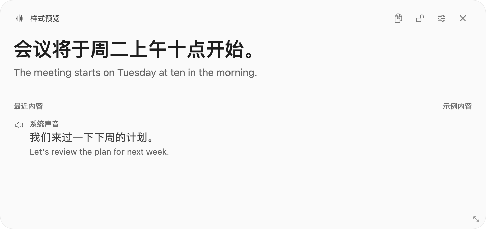
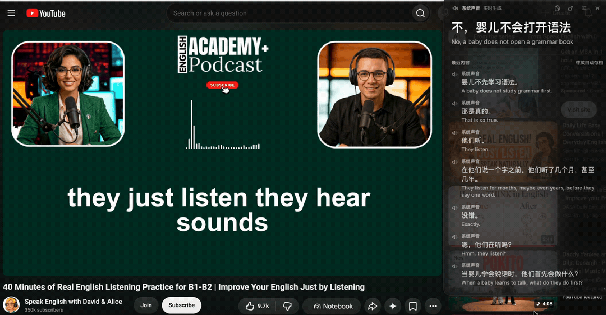
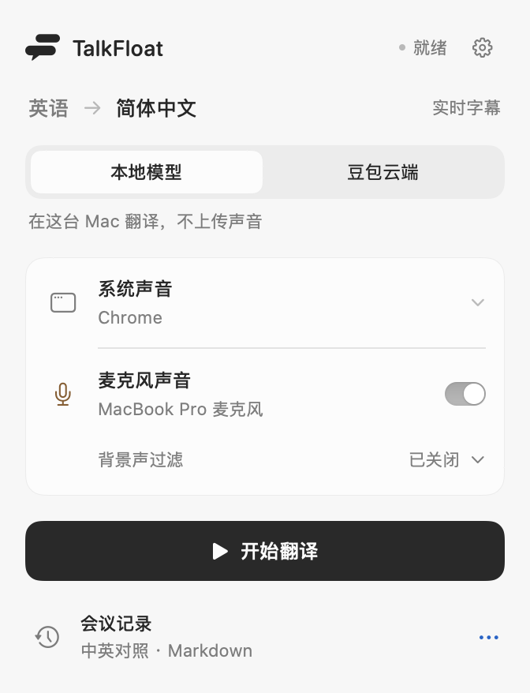

  
  <h1>TalkFloat</h1>
  
<strong>Listen in English. Follow in Chinese.</strong>

  
Live captions above your apps. Native to the macOS menu bar.

  

    
    
    
    
  

  
<a href="https://github.com/jinhan261/talkfloat/releases/tag/v0.8.7"><strong>Download DMG</strong></a> · <a href="#get-started">Get started</a> · <a href="https://github.com/jinhan261/talkfloat/issues">Report an issue</a>

  
<a href="README.md">简体中文</a> · <strong>English</strong>

  <picture>
    <source media="(prefers-color-scheme: dark)" srcset="docs/assets/caption-dark.png">
    
  </picture>

Native caption window · Sample dialogue · Adapts to GitHub's light and dark themes

## Alongside your meetings, videos and classes

- **Follow the conversation** — The current sentence stays at the top, with recent context below. Drag text or empty space to move the window; resize from any edge.
- **Two audio sources, clearly labeled** — Listen to all system audio or Chrome only, with an optional microphone channel.
- **Local or cloud** — Use Apple's local models without API charges, or connect your own Doubao account.
- **Keep a bilingual record** — Automatically save English–Chinese Markdown to a folder you choose. No audio recordings are saved.

[Watch the full demo · 27 seconds, no audio track](https://github.com/jinhan261/talkfloat/releases/download/v0.8.7/talkfloat-demo.mp4) · [Full-resolution screenshot](docs/assets/live-captions.png)

## Get started

**Apple Silicon Mac; macOS 26.4 or later recommended.** Local models require 26.4+. The Doubao build declares a minimum of 14.2; older systems still need full hardware validation. An Intel build is not available.

1. **Install** — Download the DMG from [Releases](https://github.com/jinhan261/talkfloat/releases/tag/v0.8.7), drag TalkFloat into Applications, then open it there. Look for its menu bar icon.
2. **Choose a model** — Prepare Apple's language resources for local mode, or enter your own API Key or App ID / Access Token in settings for Doubao.
3. **Start translating** — Choose the system audio source, enable the microphone if needed, and click “开始翻译” (Start). Grant the corresponding audio permissions. **Screen recording permission is not required.**
4. **Finish and review** — Click “结束并存档” (Finish and save), then “会议记录” (Meeting records) to open the Markdown files. Change their folder in settings.

  <picture>
    <source media="(prefers-color-scheme: dark)" srcset="docs/assets/menu-dark.png">
    
  </picture>

The DMG is Developer ID signed and Apple notarized, with a SHA256 checksum. This repository is currently private; downloads require a GitHub account with access. Before upgrading, finish the session and quit the old version, then replace the app. Keep only one installed copy.

## How it works

Built with **Swift, SwiftUI and AppKit**. Core Audio Process Tap captures system audio; AVAudioEngine captures the microphone. Each channel is processed independently, with results combined in the caption window and meeting record.

| | Apple local models | Doubao cloud |
| --- | --- | --- |
| Recognition and translation | SpeechAnalyzer / SpeechTranscriber, followed by low-latency TranslationSession | WebSocket connection to Volcengine's simultaneous translation service |
| Cost | No API charges | Your credentials; usage-based provider billing |
| Audio and text | Processed on-device after language resources are downloaded | Selected audio is sent to Volcengine |

Local mode uses Apple's dedicated speech recognition and translation models, **not a general-purpose chat model**. It never automatically falls back to a paid provider. Records default to `~/Library/Application Support/TalkFloat/Recordings`. Version 0.8.7 does not automatically import earlier Saylori records; custom folders remain unchanged.

Translation currently supports **English → Simplified Chinese only**; the app interface is in Simplified Chinese. The microphone gate and Voice Isolation can reduce background noise, but cannot guarantee speaker identity. Check names, numbers and technical terms, and inform meeting participants before use.

[Privacy](PRIVACY.md) · [Build from source](docs/development.md) · [Architecture](docs/architecture.md) · [Contributing](CONTRIBUTING.md) — these detailed guides are currently in Chinese.

## License

[MIT](LICENSE) © 2026 jinhan261. SpeexDSP retains its [BSD license](native/Sources/SpeexDSP/COPYING). Apple language models and Doubao services follow their own terms and are not distributed with this project. Third-party video content shown in the demo is not covered by the MIT license; see [asset notes](docs/assets/README.md).
