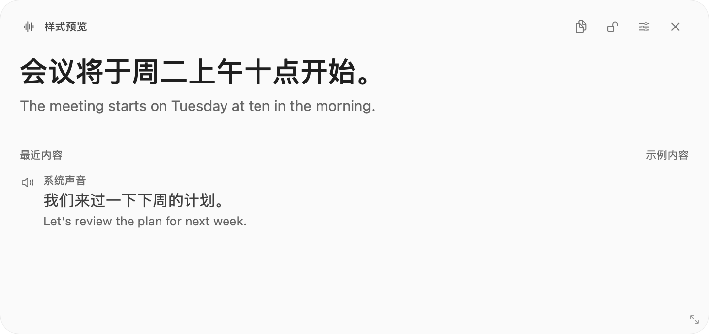
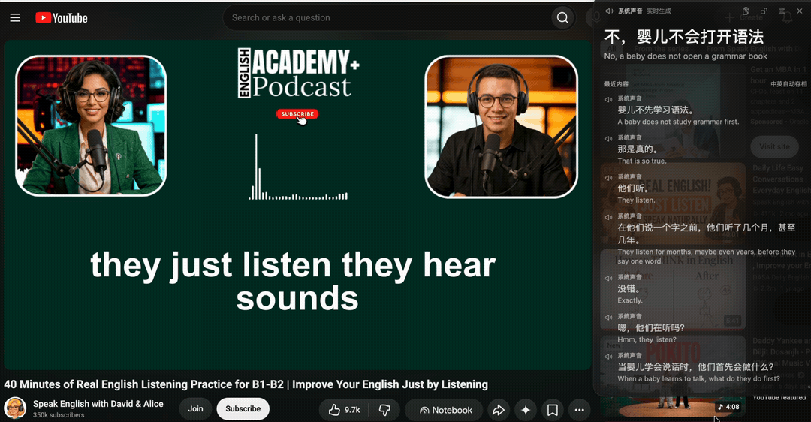
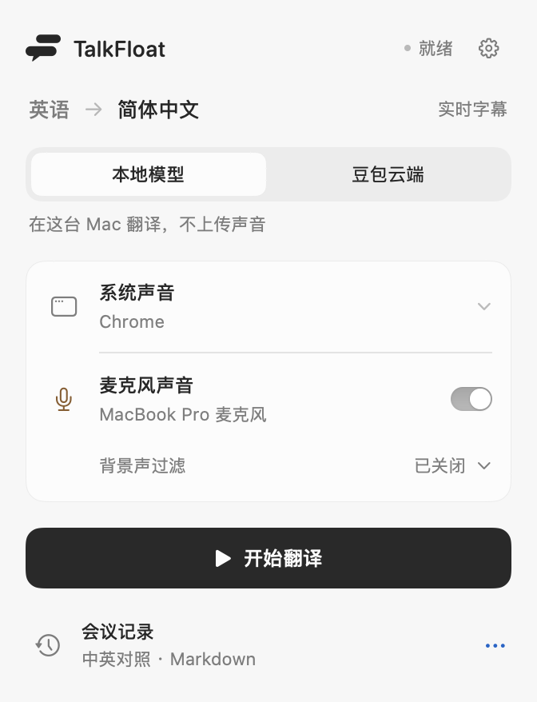

  
  <h1>TalkFloat</h1>
  
<strong>听英语，看中文。字幕浮在你正在用的 App 上。</strong>

  
原生 macOS 菜单栏工具 · 英语 → 简体中文

  

    
    
    
    
  

  
<a href="https://github.com/jinhan261/talkfloat/releases/tag/v0.8.7"><strong>下载 DMG</strong></a> · <a href="#开始使用">使用说明</a> · <a href="https://github.com/jinhan261/talkfloat/issues">反馈问题</a>

  
<strong>简体中文</strong> · <a href="README.en.md">English</a>

  <picture>
    <source media="(prefers-color-scheme: dark)" srcset="docs/assets/caption-dark.png">
    
  </picture>

原生字幕窗口 · 示例对白 · 随 GitHub 深浅色切换

## 在会议、视频和网课旁边

- **边听边看** — 当前句置顶，保留最近内容；拖动任意文字或空白区域，沿窗口各边调整大小。
- **两路声音，分别标记** — 收听全部系统声音或仅 Chrome，可同时收听麦克风。
- **本地或云端** — Apple 本地模型无需 API 费用；也可切换自己的豆包服务。
- **结束即存档** — 自动保存中英 Markdown，自选文件夹。不保存录音。

[观看完整演示 · 27 秒，无音轨](https://github.com/jinhan261/talkfloat/releases/download/v0.8.7/talkfloat-demo.mp4) · [查看原尺寸实机截图](docs/assets/live-captions.png)

## 开始使用

**Apple 芯片 Mac，推荐 macOS 26.4 或更新版本。** 本地模型要求 26.4+；豆包模式声明最低 14.2，较早系统尚待完整实机验证。暂不提供 Intel 版。

1. **安装** — 从 [Releases](https://github.com/jinhan261/talkfloat/releases/tag/v0.8.7) 下载 DMG，将 TalkFloat 拖入 Applications，再从那里打开。App 位于右上角菜单栏。
2. **选择模型** — 本地模式首次准备 Apple 语言资源；豆包模式在设置里填写自己的 API Key，或 App ID / Access Token。
3. **开始翻译** — 选系统音源，需要时打开麦克风，再点击「开始翻译」。仅需相应的系统录音和麦克风权限，**不需要录屏权限**。
4. **结束并查看记录** — 点击「结束并存档」，从「会议记录」打开 Markdown；在设置里更改存储文件夹。

  <picture>
    <source media="(prefers-color-scheme: dark)" srcset="docs/assets/menu-dark.png">
    
  </picture>

DMG 已使用 Developer ID 签名并通过 Apple 公证，附 SHA256 校验文件。当前仓库保持私有，下载需要有访问权限的 GitHub 账号。升级前结束会话并退出旧版，再替换 App，避免同时保留多个安装副本。

## 如何实现

使用 **Swift + SwiftUI + AppKit**，通过 Core Audio Process Tap 采集系统声音，通过 AVAudioEngine 采集麦克风。两路音频独立处理，结果汇入同一个字幕窗口与会议记录。

| | Apple 本地模型 | 豆包云端 |
| --- | --- | --- |
| 识别与翻译 | SpeechAnalyzer / SpeechTranscriber 转写，再由 TranslationSession 低延迟翻译 | WebSocket 连接火山引擎同声传译服务 |
| 费用 | 无 API 费用 | 使用自己的凭据，按服务用量计费 |
| 声音与文字 | 下载语言资源后在本机处理 | 所选音频发送至火山引擎 |

本地模式使用 Apple 的专用语音识别与翻译模型，**不是调用通用聊天大模型**，也不会自动切换到付费服务。默认记录目录为 `~/Library/Application Support/TalkFloat/Recordings`；0.8.7 不自动导入早期 Saylori 记录，用户选定的自定义目录保持不变。

目前仅支持英语 → 简体中文，App 界面为简体中文。麦克风门限与语音突显可以减少背景声，但不能保证只识别本人；数字、姓名和专业术语请核对。使用前请告知会议参与者。

[隐私说明](PRIVACY.md) · [源码构建](docs/development.md) · [架构](docs/architecture.md) · [参与贡献](CONTRIBUTING.md)

## 许可证

[MIT](LICENSE) © 2026 jinhan261。SpeexDSP 保留其 [BSD 许可证](native/Sources/SpeexDSP/COPYING)。Apple 语言模型与豆包服务遵循各自条款，不随项目分发。演示中的第三方视频内容不属于 MIT 授权范围，详见[素材说明](docs/assets/README.md)。
