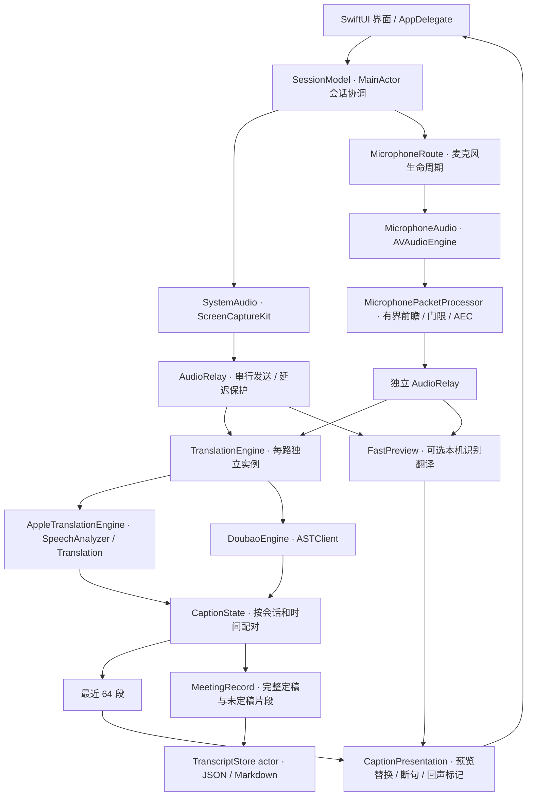

# Saylori 架构

更新：2026-11-02 · 0.7.0。采用 Swift Package；AppKit 管理菜单栏和窗口，SwiftUI 绘制内容。保持系统声与麦克风两条独立的音频、识别和字幕时间线。

## 模块职责

| 模块 | 责任 / 边界 |
| --- | --- |
| `Saylori` | 界面、会话协调、设备权限提示、本机快速预览；运行于 macOS App 环境 |
| `AppDelegate` / `SubtitlePanel` | 菜单栏、窗口生命周期 / 全窗拖动与八方向缩放 |
| `SessionModel` | 两路会话启动停止、有限重连、保存调度、可观察 UI 状态；不负责逐样本 DSP |
| `TranslationEngine` | 统一音频发送、结果流和结束语义；工厂按会议模式创建本地或豆包实例，不自动收费回退 |
| `FastPreview` | 共享设备端识别翻译管线；完整模式保留每个定稿，云端预览模式合并过时草稿 |
| `MicrophoneRoute` | 单条麦克风连接及发送/接收任务；处理器在构造时注入，运行中不替换 |
| `SayloriCore` | 采音、协议、发送策略、DSP、字幕状态、呈现规则、存档和凭据存储；不依赖 App 的界面类型 |
| `AudioRelay` | 只依赖 `AudioSending` 与单调时钟，可用假传输独立测试；每条流只有一个串行调用者 |
| `CaptionState` / `CaptionPresentation` | 前者保存服务原始片段并配对，后者组合当前可见文字；显示过滤不删除原文 |
| `MeetingRecord` / `TranscriptStore` | 可编码存档模型 / 文件读写 actor；revision 防止迟到自动保存覆盖结束版 |
| `AppTestHarness` | 只有明确测试参数时才构造；集成、视觉与生命周期验证从应用委托中独立出来 |
| `AudioRing` / `SpeexDSP` | C 有界音频 ring / 有许可证的参考回声消除实现 |

## 时间与并发约束

- 采音回调只写入预分配 ring；工作队列转成 16kHz、单声道、PCM16，通常每包 80ms。
- 系统声和麦克风各自一个发送任务。鉴权前的音频不回放追赶；排队达到 400ms 则停止并提示，不建立无限重传队列。
- 麦克风前瞻固定两包（160ms）。`MicrophonePacketProcessor` 同时负责正常发送和停止收尾，关门时输出等长静音，保留时间轴，AEC 继续适应。
- `AudioRelay` 按成功送出的 PCM 字节计算流时间，不以网络回包间隔推算音频时长。传输失败不推进时钟。
- 设备门限通过锁保护；UI 更新在 MainActor；网络与磁盘分别由 actor 管理。
- 字幕刷新从尾部读取最近 64 个非空片段，取得足够片段即停止；若尾部有空片段会继续向前跳过。存档仍读取全部已收到片段。

## 持久化与边界

凭据保存在 macOS 钥匙串，偏好保存在 UserDefaults；会议文字位于 Application Support 下的 `Saylori/Recordings`。JSON 保留服务原始片段、来源与疑似回声标记，Markdown 提供句子视图和回声附录。豆包模式的本机预览不会替代未收到的云端定稿写入存档。本地模式保存 Apple 的原文和翻译定稿，并写入 `engine: local`；旧档案缺少此可选字段仍可读取。

门限表示输入音量，不表示讲话人身份。较响旁人仍可能通过；声纹登记与说话人分离未实现。完整档案的回声匹配和序列化仍随会议增长，尚未做多小时性能验收；本轮仅消除了实时展示的整场过滤开销。

## 本地模式收尾与修订

- `LocalSpeechIdentity` 用重叠音频区间承接 Apple 定稿时对起始静音的修剪，避免同一句预览、定稿重复存档。
- `LocalTranslationQueue` 合并待处理草稿，但按顺序保留每个识别定稿；最多 32 个待翻译定稿，溢出明确停止，不静默漏句。
- 输入、识别、翻译按顺序结束，最多 12 秒收尾；超时保留未定稿并提示。停止与暂停均释放模型管线，恢复使用新会话 ID。
- 展示缓存最多保留最近 64 条已翻译配对，避免逐词识别更新使中文闪回空白；存档保存真实最新状态，不用旧译文伪造新原文的定稿。
- 两种模式的采音、麦克风门限与 AEC 路径共用，不因切换引擎取消背景声过滤。
